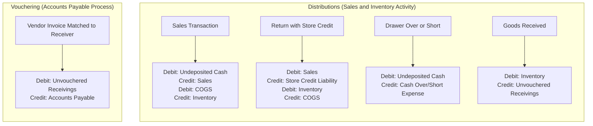

# Rapid POS Unified Accounting Connector - Version 2.01.00
Updated November 13th 2026

## Overview

The Rapid POS Unified Accounting Connector sends sales, tenders, cost of goods sold, inventory adjustments, and accounts payable from Counterpoint to your accounting system, so they don't have to be entered by hand. It is a CI/CD connector, so updates are deployed automatically with no reinstall required. For details, see [CI/CD Connector Benefits](https://github.com/Rapid-POS/Miscellaneous-Documents/blob/main/CICD-Connector-Benefits.md).

The connector works in one of two ways, depending on your accounting system:

- **Direct interface:** data is posted straight to the accounting system when distributions or vouchered receivings are interfaced in Counterpoint (QuickBooks Desktop, QuickBooks Online, Sage Intacct).
- **Export interface:** the connector writes import files, and a user imports them into the accounting system (Sage BusinessWorks).

Rapid does not sell accounting software, and Rapid supports the connector only, not day-to-day use of your accounting system.

> **Note:** This integration assumes a solid understanding of accounting and bookkeeping principles. Review the [Minimum Knowledge Requirements](#minimum-knowledge-requirements) before proceeding.

## Minimum System Requirements:

- Minimum Counterpoint version: **8.5.6.2**
- Minimum SQL Server version: **2016**
- Minimum Supported Operating System version: **Windows Server 2016** or **Windows 11 Pro**
- Minimum PowerShell version: **5.1**

> [!WARNING]
> Your environment must meet our [CI/CD Connector Requirements](https://github.com/Rapid-POS/Miscellaneous-Documents/blob/main/CICD-Connector-Requirements.md) (server access, firewall rules, etc.) before any install or upgrade. Troubleshooting, manual installs, or follow-up work resulting from unmet requirements will be billed at standard T&M rates.

If your system does not meet these minimum requirements, please consult your Care Team Lead (vCIO) for an upgrade quote.

Requirements specific to each accounting system are listed in that system's section.

## Minimum Knowledge Requirements

Before implementing the Accounting Connector, you or your financial lead should understand:

- Debits and credits
- Clearing accounts
- Bank deposit reconciliation
- Contra accounts
- Basic journal entries

If these concepts are unfamiliar, consider working with your accountant or entering data manually until your foundation is stronger. Many smaller retailers send their accountant a few Counterpoint reports each month (Sales & Tenders, Inventory Valuation, and Tax) instead of using the connector.

## Table of Contents

- [Minimum System Requirements](#minimum-system-requirements)
- [Minimum Knowledge Requirements](#minimum-knowledge-requirements)
- [Section 1: Supported Accounting Platforms](#section-1-supported-accounting-platforms)
- [Section 2: How the Connector Works](#section-2-how-the-connector-works)
- [Section 3: Transaction Responsibilities](#section-3-transaction-responsibilities)
- [Section 4: Account Interface Levels](#section-4-account-interface-levels)
- [Section 5: QuickBooks Desktop](#section-5-quickbooks-desktop)
- [Section 6: QuickBooks Online](#section-6-quickbooks-online)
- [Section 7: Sage BusinessWorks (Export Interface)](#section-7-sage-businessworks-export-interface)
- [Section 8: Interfacing Frequency and Validation](#section-8-interfacing-frequency-and-validation)
- [Section 9: Accounting Connector Messages](#section-9-accounting-connector-messages)
- [Section 10: Clearing Staged A/P Vouchers and GL Distributions](#section-10-clearing-staged-ap-vouchers-and-gl-distributions)
- [Conclusion](#conclusion)

## SECTION 1: Supported Accounting Platforms

| Platform | Interface | Section |
|---|---|---|
| QuickBooks Desktop Enterprise (versions currently supported by Intuit) | Direct | [Section 5](#section-5-quickbooks-desktop) |
| QuickBooks Online | Direct | [Section 6](#section-6-quickbooks-online) |
| Sage BusinessWorks 2025 | Export (file-based) | [Section 7](#section-7-sage-businessworks-export-interface) |
| Sage Intacct | Direct (API-based) | Coming soon. Documentation will be added when CI/CD deployment is available. |

Each platform has its own section. You only need to read the section for your system.

> [!IMPORTANT]
> **QuickBooks Desktop 2023 (including Enterprise 23.0) was discontinued by Intuit on May 31, 2026.** The software still opens, but Intuit's connected services no longer work: payroll tax updates, bank feeds, payments processing, security updates, and live support. QuickBooks Desktop Enterprise remains actively sold and supported. The connector requires a version of QuickBooks Desktop Enterprise that Intuit currently supports. If you are on an older version, upgrade before implementation or consider QuickBooks Online.

### At a Glance

| | QuickBooks Desktop | QuickBooks Online | Sage BusinessWorks |
|---|---|---|---|
| How data gets there | Posted directly through the QuickBooks SDK | Posted directly over the internet | Import files that a user imports |
| Runs where | Same machine as QuickBooks Desktop, connected to the Counterpoint server | Any machine connected to the Counterpoint server and the internet | Any machine connected to the Counterpoint server that can write to the import folder |
| A successful run means | Posted in QuickBooks Desktop | Posted in QuickBooks Online | **A file is ready, not posted** |
| Distributions become | One journal entry per date | One journal entry per date | GL import file, one journal entry per date |
| Vouchers become | Bill or vendor credit | Bill or vendor credit | AP import file (`/INVOICE` or `/CREDIT` lines) |
| Vendors | Created if missing, with terms | Created if missing, with terms | Vendor file, each vendor sent once |
| Message Center group | `ACCTG_QBD` | `ACCT_QBO` | `ACCTG_SAGEBW` |

For all platforms, one install serves one Counterpoint company. Use a separate install folder for each company.

## SECTION 2: How the Connector Works

The Accounting Connector has two main components.

### Vendor Payables (Vouchering Receivers)

Merchandise receipts entered in Counterpoint create accounts payable entries in your accounting system. A positive voucher becomes a vendor bill, and a negative voucher becomes a vendor credit.

### General Ledger (Distributions)

Counterpoint sends the following to your accounting system:

- Sales
- Tenders
- Cost of Goods Sold (COGS)
- Inventory adjustments
- Inventory value
- A/R balance

### Accounting Flow Overview

### When the Connector Runs

The connector does not run on a schedule. It runs when a user takes one of these actions in Counterpoint:

- **Interface Distributions** sends general ledger distributions.
- **Voucher Receiving** sends vouchers.

## SECTION 3: Transaction Responsibilities

You and your bookkeeper need to understand which system is responsible for each type of transaction.

| Area | Counterpoint | Your Accounting System |
|---|---|---|
| Item-level data | Manages all item-level data | Inventory held at GL level (no item detail required) |
| Accounts receivable | Manages A/R | A/R held at GL level (no account detail required) |
| Accounts payable | Does not manage A/P | A/P account detail managed here |
| Non-merchandise expense | Rarely used | Managed here (rent, utilities, payroll, etc.) |

Contact your Rapid POS representative for the full transaction responsibility matrix, which covers what Counterpoint manages, what the connector automates, and what must be handled directly in your accounting system.

## SECTION 4: Account Interface Levels

Counterpoint can interface transactions to your accounting system at different levels of detail. Choose one level. Any level other than None is an add-on. Please contact Rapid for a quote.

| Level | Example Sales Account #s | Notes |
|---|---|---|
| None | 3000 | Most common |
| Store/Location | 3000-100 (store 100), 3000-101 (store 101) | Multi-store clients |
| Category | 3000-40 (category 40), 3000-50 (category 50) | Extremely detailed, not recommended |
| Subcategory | 3000-440 (subcategory 440), 3000-450 (subcategory 450) | Extremely detailed, not recommended |
| Account Code | 3000-1 (merchandise 1), 3000-2 (services 2) | Category (department) level detail |
| Combination | 3000-100-1 (store 100, merchandise 1), 3000-101-2 (store 101, services 2) | Store plus account code |

Note: Sage BusinessWorks receives only the GL account segment. Levels other than None are not carried into BusinessWorks import files.

## SECTION 5: QuickBooks Desktop

**Supported:** QuickBooks Desktop Enterprise, versions currently supported by Intuit. See the QuickBooks Desktop 2023 notice in [Section 1](#section-1-supported-accounting-platforms).

### Requirements

- QuickBooks Desktop installed on the **same machine** as the connector, with the QBFC16 SDK.
- The path to the company file (`.qbw`).
- Account numbers enabled in QuickBooks. Every Counterpoint account that is sent must exist in QuickBooks with the **same account number**.
- The RposCrypt key store copied to each workstation that interfaces distributions or vouchers, so it holds the same key that encrypted the values. A new workstation without the key can't run the connector. Rapid Support handles this setup.

### What It Does

- **Distributions:** one journal entry per distribution date. The reference is the GL batch number, and the profit center is sent as the QuickBooks class.
- **Vouchers:** a bill for a positive voucher and a vendor credit for a negative one. Missing vendors and vendor terms are created first. Several users can voucher at the same time; runs are queued so each voucher is posted only once.

### Running It

- Distributions run from **Interface Distributions** and vouchers run from **Voucher Receiving**. Both launch `QBD -c <alias> -r D|V -f "<path to .qbw>"`.
- QuickBooks Desktop must be open with the company file loaded. The file path, including the `.qbw` extension, must match the path configured in Counterpoint's accounting interface. To confirm it, check **File > Open Previous Company** in QuickBooks Desktop. It should show exactly the same path.

### Common Problems

- An account number is missing in QuickBooks.
- A vendor name already exists in QuickBooks as a customer.
- The company file was opened from a different path than the one configured in Counterpoint.
- More than one company file is open during the run.

## SECTION 6: QuickBooks Online

### Requirements

- Invite programming@rapidpos.com to your QuickBooks Online company as an Accountant user.
- Set up Accounts and Classes in QuickBooks Online first, then map them to accounts and classes in Counterpoint.

### Data Flow

The sync is one-way, from Counterpoint to QuickBooks Online. It sends vendors, vendor terms, distributions, and vouchered receivings and RTVs. No data is imported from QuickBooks Online into Counterpoint.

| Object/Segment | Source | Destination | Contents |
|---|---|---|---|
| Journal Entry | Counterpoint | QuickBooks Online | Journal Entry #, Transaction Date, Adjustment, Journal Entry Lines |
| Journal Entry Line | Counterpoint | QuickBooks Online | Amount, Detail Type, Description, Posting Type, Class, Account |
| Vendor | Counterpoint | QuickBooks Online | Address, Account #, Company Name, Display Name, Print on Check Name, Active, Phone # (Primary), Web Address |
| Vendor Credit | Counterpoint | QuickBooks Online | Account, Total Amount, Transaction Date, Vendor Credit #, Private Note, Vendor Credit Lines |
| Vendor Credit Line | Counterpoint | QuickBooks Online | Amount, Description, Detail Type, Account |
| Vendor Bill | Counterpoint | QuickBooks Online | Account, Total Amount, Transaction Date, Vendor Bill #, Private Note, Vendor Bill Lines |
| Vendor Bill Line | Counterpoint | QuickBooks Online | Amount, Description, Detail Type, Account |
| Vendor Terms | Counterpoint | QuickBooks Online | Name, Active, Type, Discount Percent, Days Due, Day of Month Due |

### What It Does

- **Distributions:** one journal entry per date, with the profit center sent as the QuickBooks class. If the batch number is already used in QuickBooks Online, the connector moves to the next batch number and saves it back to Counterpoint.
- **Vouchers:** a bill for a positive voucher and a vendor credit for a negative one. Vendors are matched by QuickBooks display name against the Counterpoint AP vendor number, or the vendor number if there is no AP vendor number.

### Sign-In and Tokens

- The sign-in is stored **encrypted in the Counterpoint database**, not per Windows user, so any account can run the connector.
- Access is renewed automatically at the start of each run. Two runs at the same time do not overwrite each other.
- You only need to sign in again if QuickBooks Online stops accepting the saved sign-in, for example if access was disconnected or there was a long gap between runs.

### Running It

Distributions run from **Interface Distributions** and vouchers run from **Voucher Receiving**. Both launch `QBO -c <alias> -r D|V`.

### Common Problems

- Missing accounts in QuickBooks Online.
- "Failed to load QBO tokens." Sign in again.
- A vendor display name in QuickBooks Online matches a different vendor number.

## SECTION 7: Sage BusinessWorks (Export Interface)

Other programs can't write directly to BusinessWorks, so this connector works differently from the other platforms. It turns Counterpoint's pending GL distributions and AP vouchers into files in BusinessWorks' import format, and a user imports them.

**A successful run means a file is ready. It does not mean the data is in BusinessWorks yet.**

For full import and validation steps, refer to the [Sage BusinessWorks Connector User Guide](https://github.com/Rapid-POS/Miscellaneous-Documents/blob/main/SAGE-Businessworks-Connector-%20Export-Interface-User-%20Guide.md).

### Requirements

- A folder for the files, set as `IMPORT_FOLDER_PATH`. This is required, and the run stops if it isn't set.
- The account running the connector must be able to write to that folder.

### Files and Import Order

Files are written to the import folder (typically `C:\CPAccounting\BW\Export`), and a Message Center note is created in Counterpoint for each file.

| File | Contents | Import With (in BusinessWorks) |
|---|---|---|
| `Vendor_Import_<datetime>.csv` | Vendors with a voucher in the run that haven't been sent before | AP > Transfer > Import Vendor Information |
| `AP_Import_<datetime>.csv` | Vendor bills and vendor credits | AP > Transfer > Import Invoices/Adjustments |
| `GL_Import_<batch>_<datetime>.csv` | General ledger journal entries | GL > Transfer > Import Journal Entries |

Import the vendor file first (when there is one), then AP, then GL. BusinessWorks rejects an invoice for a vendor it doesn't have yet. The GL file doesn't depend on the others.

After the files are imported, archive or delete them so they aren't imported twice. If Counterpoint's A/P file setting is **A** (append), one AP file and one vendor file are used per day and every run adds to them, so move them after importing.

### Running It

- Distributions: **Interface Distributions** launches `SAGEBW -c <alias> -r D`.
- Vouchers: **Voucher Receiving** launches `SAGEBW -c <alias> -r V`.

### Limits and Behavior

- **GL:** one journal entry per distribution date, all in the General (GEN) journal, with the Counterpoint GL batch number as the reference. Maximum of 999 entries per file. Only the GL account segment is sent (no profit center).
- **AP:** a positive voucher becomes an `/INVOICE` line and a negative voucher becomes a `/CREDIT` line (an open vendor credit). Payment terms and discounts are not sent, only the due date. Maximum of 20 distribution lines per voucher. A voucher over that limit is skipped, raises an alert, and stays in Counterpoint for the next run. The reference is cut off at 20 characters.
- **Vendors:** only vendors with a voucher in the run that haven't been sent before. Plain ASCII only: accented characters are reduced to the base letter, and phone numbers are sent only if they have exactly 10 digits. A vendor BusinessWorks would reject (missing name, address, city, state or zip, or an ID longer than 12 characters) is held back and named in a Vendor Alert.

### Important Notes

- Connector errors do not stop Counterpoint (the connector exits with code 0), so **watch the Message Center**. See [Section 9](#section-9-accounting-connector-messages).
- If Counterpoint warns that unposted G/L transactions are already on file, stop and check the last GL file before continuing. Continuing without checking can create duplicates.

### Common Problems

- `IMPORT_FOLDER_PATH` is not set.
- A voucher has more than 20 distribution lines (it is skipped and stays staged).
- Vendors are listed in a Vendor Alert.
- No file appears, because nothing was staged or the run failed.

## SECTION 8: Interfacing Frequency and Validation

You control how often data is sent, because the connector runs only when you use **Interface Distributions** and **Voucher Receiving** in Counterpoint.

### Process Distributions One Date at a Time

If you have a high transaction volume, run **Interface Distributions** for each date instead of one large batch covering a week or a month. Smaller batches:

- Are easier to reconcile, because each date can be compared to your accounting system on its own.
- Make problems easier to find and fix, because a failed run affects one date, not a whole period. Once the connector has run, its staged distributions are cleared even if the run fails, so a large batch means a lot of data to transfer again.
- Stay within file limits, such as the 999 journal entries per file in Sage BusinessWorks.

### Validate After Each Run

Before running the next date, compare Counterpoint's **Distributions by Account Number (Summary)** report with your accounting system for the same date.

Duplicates usually happen when a run that actually posted (or wrote a file) looked like it failed and was repeated. Validating each date first means a duplicate is caught as one entry, not many.

## SECTION 9: Accounting Connector Messages

The connector reports alerts and file notifications to the Counterpoint **Message Center**. Each accounting system has its own Message Center group:

| Platform | Message Center Group |
|---|---|
| QuickBooks Desktop | `ACCTG_QBD` |
| QuickBooks Online | `ACCT_QBO` |
| Sage BusinessWorks | `ACCTG_SAGEBW` |

At least one person responsible for accounting should belong to the group for your system. Otherwise alerts will go unnoticed. This is especially important for Sage BusinessWorks, where a failed run does not stop Counterpoint.

## SECTION 10: Clearing Staged A/P Vouchers and GL Distributions

If an error occurs on the Counterpoint side before the connector runs, the transactions stay in staging. This applies to all platforms.

Staged data must be cleared manually before you try again:

- Otherwise, old and new rows can both be sent, which creates duplicate entries.
- A staged voucher can also stop Counterpoint from staging the same vendor and voucher number again.

### How to Clear Staged Data

Go to **Connectors > Accounting** and choose:

- **Clear Staged A/P Vouchers**
- **Clear Staged GL Distributions**

Each item opens an action. Select **Run** to clear it. Nothing is sent to the accounting system, and the staged rows are deleted.

Important: Before clearing, check your accounting system for the affected dates so you only re-transfer what is actually missing.

## Conclusion

The Rapid POS Unified Accounting Connector moves sales, inventory, and payables data from Counterpoint into your accounting system so it doesn't have to be entered by hand.

Before go-live, confirm that:

- Your chart of accounts matches the Counterpoint account numbers.
- Account-number dimension settings are configured.
- Someone belongs to the Message Center group for your system.
- A test transfer reconciles in both systems.
- Vouchering and Distributions training is complete.

Historical transactions: if you used Counterpoint before your chart of accounts was configured, those earlier transactions can't be interfaced as they are. Rapid can edit the history so it can be interfaced, for an additional fee. Most clients interface only transactions from after the chart of accounts is configured.

After deployment, interface one date at a time, validate each run, and keep an eye on the Message Center.

For help with configuration, account mapping, or troubleshooting, contact Rapid Support.
