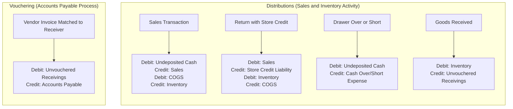

# Rapid POS Unified Accounting Connector
**Updated November 6th 2026**

The Rapid POS Unified Accounting Connector automates the synchronization of sales, tender, and inventory data between CounterPoint and your accounting system — reducing manual data entry and improving financial accuracy.

> **Note:** This integration assumes a solid understanding of accounting and bookkeeping principles. Without that foundation, the connector may feel complex or introduce confusion into your financial processes. Review the [Accounting Knowledge Self-Assessment](#section-1-accounting-knowledge-self-assessment) before proceeding.

---

## Overview

The Unified Accounting Connector eliminates manual financial data entry by pushing sales, tenders, cost of goods sold, inventory adjustments, and accounts payable directly from CounterPoint into your accounting platform. It is continuously maintained and deployed through Rapid's CI/CD pipeline, meaning updates are delivered automatically with no manual reinstalls required.

👉 [Release Notes & Documentation](https://github.com/Rapid-POS)

---

## Supported Accounting Platforms

- QuickBooks Desktop
- QuickBooks Online
- Sage Intacct *(CI/CD deployment coming soon)*
- **Sage BusinessWorks (Export Interface)** **— file-based. The connector creates import files and a user imports them into BusinessWorks. See [Sage BusinessWorks Export Interface](#sage-businessworks-export-interface).**

### **Direct vs. Export Interfaces**

- **Direct interface: data is sent straight to the accounting system when distributions or vouchered receivings are interfaced in CounterPoint (QuickBooks Desktop, QuickBooks Online, Sage Intacct).**
- **Export interface: instead of posting data directly, the connector writes it to import files that a user then imports into the accounting system (Sage BusinessWorks).**

---

## Minimum System Requirements:
- Minimum Counterpoint version: **8.5.6.2**  
- Minimum SQL Server version: **2016**  
- Minimum Supported Operating System version: **Windows Server 2016** or **Windows 11 Pro** 
- Minimum PowerShell version: **5.1**

> [!WARNING]
> Your environment must meet our [CI/CD Connector Requirements](https://github.com/Rapid-POS/Miscellaneous-Documents/blob/main/CICD-Connector-Requirements.md) (server access, firewall rules, etc.) before any install or upgrade. Troubleshooting, manual installs, or follow-up work resulting from unmet requirements will be billed at standard T&M rates.

If your system does not meet these minimum requirements, please consult your Care Team Lead (vCIO) for an upgrade quote.

---

## Table of Contents

- [CI/CD Deployment Model](#cicd-deployment-model)
- [Minimum Knowledge Requirements](#minimum-knowledge-requirements)
- [Section 1: Accounting Knowledge Self-Assessment](#section-1-accounting-knowledge-self-assessment)
- [Section 2: Connector Overview](#section-2-connector-overview)
  - **[QuickBooks Online Data Flow](#quickbooks-online-data-flow)**
  - **[Sage BusinessWorks Export Interface](#sage-businessworks-export-interface)**
- [Section 3: Transaction Responsibilities](#section-3-transaction-responsibilities)
- [Section 4: Integration Frequency Options](#section-4-integration-frequency-options)
- [Section 5: Costs and Pricing](#section-5-costs-and-pricing)
- **[Section 6: Account Interface Levels](#section-6-account-interface-levels)**
- **[Section 7: Implementation Steps](#section-7-implementation-steps)**
- [Conclusion](#conclusion)

---

## CI/CD Deployment Model

Starting in 2024, Rapid transitioned its connectors to a **CI/CD (Continuous Integration / Continuous Deployment)** model. This modern approach ensures your connector is continuously updated, more reliable, and future-proof.

### What You Get

With a CI/CD connector, you receive:

- **Automatic bug fixes** —issues are often resolved before you notice them
- **Automatic feature enhancements** — new capabilities are delivered as they become available
- **Compatibility updates** — when third-party platforms change their APIs or systems, Rapid can deploy fixes before your business is affected
- **Reduced downtime** — fewer disruptions, fewer maintenance windows
- **Predictable monthly pricing** — no surprise labor charges for individual updates

### How It Used to Work

Previously, every bug fix or new feature had to be manually reinstalled for each client that requested it. This meant labor billed at Rapid's standard hourly rate, delays while updates were rolled out individually, and unexpected costs with little advance notice. CI/CD eliminates this cycle — updates are deployed automatically across all clients with no reinstall required.

### What Your Subscription Supports

CI/CD connectors are actively maintained products, not one-time software installations. Your subscription funds:

- New features and functionality
- Ongoing maintenance, bug fixes, and performance improvements
- Compatibility updates when third-party platforms change their APIs or systems
- Infrastructure required for automated deployments

This ensures every client benefits from improvements as they are released — not just those who ask.

### Deployment Notifications and Release Notes

Rapid will attempt to provide at least 24 hours' notice prior to scheduled connector upgrades, along with an estimated deployment window. In rare circumstances, an important update may need to be deployed on short notice or without notice.

Release notes and version history for all CI/CD connectors are available on GitHub:
👉 [https://github.com/Rapid-POS](https://github.com/Rapid-POS)

---

## Minimum Knowledge Requirements

Before implementing the Accounting Connector, you or your financial lead should understand:

- Debits and credits
- Clearing accounts
- Bank deposit reconciliation
- Contra accounts
- Basic journal entries

If these concepts are unfamiliar, consider working with your accountant or using manual processes until your foundation is stronger.

---

## Section 1: Accounting Knowledge Self-Assessment

### Should You Connect CounterPoint to Your Accounting System?

Connecting CounterPoint to a financial system is not the right choice for every business. This decision should be based on your store's processes, preferences, and level of accounting expertise.

### Manual vs. Automated Approaches

Some retailers prefer a **manual workflow**, which may include running reports from CounterPoint, sending those reports to an accountant, and entering summary data manually into their accounting system. CounterPoint fully supports this approach by providing the necessary reporting tools.

**Many smaller retailers print a handful of CounterPoint reports each month and send them to their accountant:**

- **Sales & Tenders Report**
- **Inventory Valuation Report**
- **Tax Report**

**Skipping the integration is a reasonable choice if your store is small or your bookkeeping expertise is limited.**

### When Integration Adds Value

If you or your financial lead have a solid understanding of accounting and bookkeeping principles, the Accounting Connector can provide significant benefits:

- Reduced manual data entry
- Improved accuracy
- Better financial visibility
- More timely reporting

### When to Proceed with Caution

If your accounting foundation is limited, the connector may feel intimidating, difficult to manage, or frustrating to troubleshoot. In these cases, a manual approach may produce better results until your processes and knowledge are more developed.

### Self-Assessment Questions

Use the following questions to evaluate your readiness before proceeding with implementation.

---

**Q1: Clearing Account Transactions**

When a sale occurs, a credit is recorded in sales and a debit in an undeposited tender account. What happens when funds are deposited?

- Debit: Cash account
- Credit: Undeposited tender account
This clears the transaction from the clearing account.

---

**Q2: Purpose of Clearing Accounts**

Clearing accounts provide a control point. Any remaining balance highlights discrepancies between expected and actual deposits, enabling reconciliation.

---

**Q3: Contra Accounts**

A contra account carries an opposite balance to its classification.

**Example:** Merchandise returns tracked separately from sales, enabling clearer financial reporting.

---

**Q4: Cash Drawer Shortage**

- Debit: Cash Over/Short Expense
- Credit: Undeposited Cash

---

**Assessment Summary**

If these concepts are well understood, the connector can provide strong value. If not, consider using CounterPoint reports and manually entering data into your accounting system until your accounting foundation is stronger.

---

## Section 2: Connector Overview

The Accounting Connector consists of two primary components.

### 1. Vendor Payables (Vouchering Receivers)

Merchandise receipts entered in CounterPoint generate **accounts payable entries** in your accounting system (e.g., QuickBooks).

### 2. General Ledger (Distributions)

CounterPoint pushes the following data to your accounting system:

- Sales
- Tenders
- Cost of Goods Sold (COGS)
- Inventory adjustments
- Inventory value
- **A/R balance**

### Accounting Flow Overview

### **QuickBooks Online Data Flow**

**The QuickBooks Online integration pushes Vendors, Vendor Terms, Distributions, and Vouchered Receivings/RTVs from CounterPoint to QuickBooks so you can manage business expenses in your accounting software. The sync is one-way. No data from QuickBooks is imported into CounterPoint.**

**Accounts and Classes must be set up in QuickBooks first, then mapped to an account and class in CounterPoint.**

| **Object/Segment** | **Source** | **Destination** | **Contents** |
|---|---|---|---|
| **Journal Entry** | **CounterPoint** | **QuickBooks Online** | **Journal Entry #, Transaction Date, Adjustment, Journal Entry Lines** |
| **Journal Entry Line** | **CounterPoint** | **QuickBooks Online** | **Amount, Detail Type, Description, Posting Type, Class, Account** |
| **Vendor** | **CounterPoint** | **QuickBooks Online** | **Address, Account #, Company Name, Display Name, Print on Check Name, Active, Phone # (Primary), Web Address** |
| **Vendor Credit** | **CounterPoint** | **QuickBooks Online** | **Account, Total Amount, Transaction Date, Vendor Credit #, Private Note, Vendor Credit Lines** |
| **Vendor Credit Line** | **CounterPoint** | **QuickBooks Online** | **Amount, Description, Detail Type, Account** |
| **Vendor Bill** | **CounterPoint** | **QuickBooks Online** | **Account, Total Amount, Transaction Date, Vendor Bill #, Private Note, Vendor Bill Lines** |
| **Vendor Bill Line** | **CounterPoint** | **QuickBooks Online** | **Amount, Description, Detail Type, Account** |
| **Vendor Terms** | **CounterPoint** | **QuickBooks Online** | **Name, Active, Type, Discount Percent, Days Due, Day of Month Due** |

### **Sage BusinessWorks Export Interface**

**BusinessWorks can't be written to by other programs, so this connector works differently from the other platforms. It turns CounterPoint's pending GL distributions and AP vouchers into files in BusinessWorks' import format, and a user imports them. A successful run means a file is ready. It doesn't mean the data is in BusinessWorks yet.**

**Files are written to `C:\CPAccounting\BW\Export`, and a Message Center note is created in CounterPoint for each one.**

| **File** | **Contents** | **Import With (in BusinessWorks)** |
|---|---|---|
| **`Vendor_Import_<datetime>.csv`** | **New or changed vendors** | **AP > Transfer > Import Vendor Information** |
| **`AP_Import_<datetime>.csv`** | **Vendor bills and vendor credits** | **AP > Transfer > Import Invoices/Adjustments** |
| **`GL_Import_<batch>_<datetime>.csv`** | **General ledger journal entries** | **GL > Transfer > Import Journal Entries** |

**Import order: Vendor file first (when there is one), then AP, then GL. BusinessWorks rejects an invoice for a vendor it doesn't have yet. The GL file doesn't depend on the others. Once files are imported, archive or delete them so they aren't imported twice.**

#### **Limits and Behavior**

- **GL: One journal entry per distribution date, all in the General (GEN) journal, with the CounterPoint GL batch number as the reference. Max 999 entries per file. Only the GL account segment is sent (no profit center).**
- **AP: One line per voucher. Payment terms and discounts are not sent, only the due date. Max 20 distribution lines per voucher. A voucher over that limit is skipped, raises an alert, and stays in CounterPoint for the next run. The reference is cut off at 20 characters.**
- **Vendors: Only vendors with a voucher in the run that haven't been sent before. Plain ASCII only. Accented characters are reduced to the base letter, and phone numbers are sent only if they have 10 digits.**

#### **Alerts and Validation**

**If the connector fails, a Sage BusinessWorks … Alert note appears in the CounterPoint Message Center (ACCTG_SAGEBW group). If CounterPoint warns that unposted G/L transactions are already on file, stop and check the last GL file before you continue. Continuing without checking can create duplicates.**

**To validate, compare CounterPoint's Distributions by Account Number (Summary) report with BusinessWorks' Journal Entry Batch Report for the same date. See the Sage BusinessWorks Connector User Guide for the full steps.**

---

## Section 3: Transaction Responsibilities

To ensure accurate financial reporting, you and your bookkeeper must clearly understand which system is responsible for each type of transaction. The Accounting Connector is designed to automate the flow of key financial data into your accounting system while maintaining a clear separation of responsibilities between systems.

| **Area** | **CounterPoint** | **Your Accounting System** |
|---|---|---|
| **Item-level data** | **Manages all item-level data** | **Inventory held at GL level (no item detail required)** |
| **Accounts receivable** | **Manages A/R** | **A/R held at GL level (no account detail required)** |
| **Accounts payable** | **Does not manage A/P** | **A/P account detail managed here** |
| **Non-merchandise expense** | **Rarely used** | **Managed here (rent, utilities, payroll, etc.)** |

Refer to your Rapid POS representative for a full transaction responsibility matrix covering what CounterPoint manages, what the connector automates, and what must be handled directly in your accounting system.

---

## Section 4: Integration Frequency Options

You can control how often data is synchronized between CounterPoint and your accounting system.

### Common Options

- 3 times per day
- Daily
- Weekly
- Monthly

### Considerations

When choosing a frequency, consider your transaction volume, reporting needs, and reconciliation processes. Higher-volume stores typically benefit from more frequent syncs to keep financial data current and reduce end-of-period reconciliation effort.

---

## Section 5: Costs and Pricing

### General Notes

- Rapid does **not sell accounting software** — accounting software must be sourced separately
- Rapid supports the connector only, not accounting system usage
- No third-party tools are required

### Baseline Pricing (Single Location)

| Platform | Setup | Monthly |
|---|---|---|
| QuickBooks Desktop | $999.00 | $65.00/mo |
| QuickBooks Online | $999.00 | $65.00/mo |
| Sage Intacct | $2,800.00 | $65.00/mo |
| **Sage BusinessWorks (Export Interface)** | **TBD** | **TBD** |

### Additional Options

| Option | Cost |
|---|---|
| Custom Chart of Accounts | $624.00 |
| Category / Subcategory / Multi-Location | $468.00 |
| Align Account Codes (up to 20) | $624.00 |

> Additional account configuration is billed at standard hourly rates.

---

## **Section 6: Account Interface Levels**

**CounterPoint can interface transactions to your accounting system at different levels of detail. Choose one. Any level other than None is an add-on (see [Section 5](#section-5-costs-and-pricing)).**

| **Level** | **Example Sales Account #s** | **Notes** |
|---|---|---|
| **None** | **3000** | **Most common** |
| **Store/Location** | **3000-100 (store 100), 3000-101 (store 101)** | **Multi-store clients** |
| **Category** | **3000-40 (category 40), 3000-50 (category 50)** | **Extremely detailed, not recommended** |
| **Subcategory** | **3000-440 (subcategory 440), 3000-450 (subcategory 450)** | **Extremely detailed, not recommended** |
| **Account Code** | **3000-1 (merchandise 1), 3000-2 (services 2)** | **Category (department) level detail** |
| **Combination** | **3000-100-1 (store 100, merchandise 1), 3000-101-2 (store 101, services 2)** | **Store plus account code** |

---

## **Section 7: Implementation Steps**

| **Step** | **Client Activities** | **Rapid's Activities** |
|---|---|---|
| **1** | **Tell Rapid which accounting system you plan to use, including the specific version.** | **Verify the software is compatible with your installed version of CounterPoint. Schedule a CounterPoint upgrade if needed.** |
| **2** | **Install the accounting system on a computer on your network and complete the registration process with the software vendor.** | **Your bookkeeper is usually the best person to install it. Rapid can do the install for an additional charge.** |
| **3** | **Get familiar with your accounting system. Be sure to enable account numbers.** | **Rapid can train you on interfacing to the accounting system. Rapid can't train you on using the accounting system itself; your bookkeeper should provide that.** |
| **4** | **If applicable, determine your Chart of Accounts and account numbers using the mapping document Rapid provides.** | **Conduct the Chart of Accounts review, enter account mappings in CounterPoint, and configure and test the integration.** |
| **5** | **Once you're selling in CounterPoint, attend training and begin vouchering and interfacing distributions on the schedule you chose.** | **Conduct the Vouchering and Distributions training classes.** |

> **Historical transactions:** if you used CounterPoint before your Chart of Accounts was configured, those earlier transactions can't be interfaced as-is. For an additional fee, Rapid can edit the history so it can be interfaced. Most clients choose to interface only transactions from after the Chart of Accounts is configured.

---

## Conclusion

The Rapid POS Unified Accounting Connector streamlines financial workflows by automating data transfer between CounterPoint and your accounting system. Successful implementation depends on a solid accounting foundation, clear process ownership, and proper configuration.

**Key benefits:**

- Reduced manual data entry
- Improved accuracy
- Better financial visibility
- Continuous updates through CI/CD — no manual reinstalls

Before go-live, complete the self-assessment in Section 1, confirm your environment meets the system requirements, and review transaction responsibilities with your bookkeeper or accountant.

For assistance with setup, evaluation, or configuration, contact Rapid Support.
